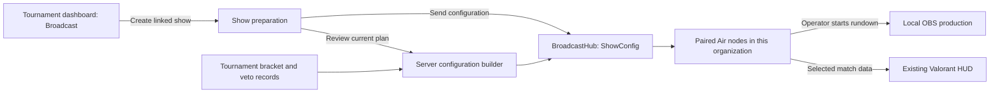

# Tournament operations to Esportra Air

14 October 2026. The tournament dashboard entry was missing from the earlier standalone broadcast pass. This continuation implements the dashboard-to-show-to-Air flow in the existing platform and existing HUD. Locally verified; not deployed or independently accepted.

## Organizer entry

Open the tournament management dashboard and choose **Run → Broadcast**. The existing route now accepts:

```text
/organizer/tournament/:slug?tab=broadcast
```

The Broadcast panel lists only this tournament's shows and creates a show bound by the server to this tournament and its organization. It includes production-desk pairing, guided preparation, rundown and recorded-activity links. Guided setup and show details link back to the tournament's Broadcast panel.

Current broadcast administration is organization-owner scoped. The tournament organizer can see an eligibility explanation but does not inherit organization-wide node or crew controls automatically. Assigned broadcast crew use their existing crew workspace. Staff cannot obtain access by changing the tab parameter.

If a creator's tournament has no organization, the panel offers that creator's owned organizations. **Link organization & create show** associates the tournament and creates its first show atomically. The server verifies both tournament creator and target organization owner. An existing organization link cannot be moved through this endpoint. This does not create, transfer or broaden staff permissions.

## Connection to Air



The server reads current tournament identity/game, configured bracket matches, resolved real/mock/solo teams and logos, best-of, series scores, map pool and recorded veto. Talent, sponsor metadata and persisted rundown are included in the same configuration. Veto side-selection actions are combined with their map picks; decider and unknown actors stay neutral. No team-link tokens are selected or transmitted.

The final preparation step previews the server's current configuration. **Send configuration** rebuilds the latest plan and emits `ShowConfig` through BroadcastHub to this organization's connected nodes. This is an organization-wide delivery contract, not per-node assignment or an acknowledgment of workstation readiness.

Air retains the configuration locally. Selecting a match selects that match's teams and veto; a match without veto clears the prior match's veto. Map pool and event identity reach the existing HUD. Configuration does not start capture, take an OBS scene, or start the rundown. Active capture/rundown defers new configuration until an operator explicitly applies it when idle.

Tournament edits do not automatically take a scene or overwrite live state. Send an updated configuration after relevant tournament changes, then verify receipt in Air. Game capture remains Valorant-specific; other games require appropriate manual production sources. Official tournament results remain subject to their existing result/crew authorization, separate from local HUD correction.

## Contracts and tenant scope

| Contract | Purpose |
| --- | --- |
| `GET /api/tournaments/:tournamentId/broadcast` | Authorized tournament workspace, eligibility and bounded linked-show list |
| `POST /api/tournaments/:tournamentId/broadcast/shows` | Create a show with authoritative tournament/organization binding; optionally link a creator's unassigned tournament to an owned organization |
| `GET /api/broadcast/shows/:showId/configuration` | Owner-authorized current server configuration preview |
| `POST /api/broadcast/shows/:showId/push-config` | Send current plan through the existing authenticated hub |

Setup pairing/node queries now use the loaded show's organization, not a default organization from the profile. This matters when an owner manages several organizations. Show list/detail, home and configuration reads also reject foreign tournament metadata and filter foreign match bindings written outside the normal API. Veto is read only for the authorized configured matches. Existing RLS is unchanged; no migration was added.

The dashboard router also now passes its existing participant data to the format/stages panel, fixing an ignored prop/type mismatch encountered while wiring the navigation. No participant permission or competition rule changed.

## Verification and artifacts

- Core: 246 tests passed, including veto order, later side choices, neutral decider and missing-map handling. API/test project builds with zero errors and four existing fake-ADO warnings.
- Web: 84 focused tests passed, including dashboard visibility/deep-link resolution, tournament-bound creation, exact organization pairing, owner denial and explicit organization linking. Production build and required chunk/button/JSX audits pass. Affected files have no scoped TypeScript diagnostics; unrelated global errors remain.
- Browser: 18 local fixture workflow checks passed, with 16 web screenshots. The tournament screenshot uses the real dashboard nav and Broadcast panel with synthetic owner context. Full hosted dashboard/auth/database integration is not claimed.
- Air: 43 tests and 11 native fixture checks passed; renderer and unsigned installer rebuilt. Packaged dependencies and capture SDK checks passed. Current installer hash is recorded in `D:/Esportra-Air/docs/audits/product-smoke/package-result.json`; it supersedes the earlier product checkpoint's hash.
- New PostgreSQL integration tests compile for authoritative binding, organization linking, owner boundaries and foreign match rejection. They remain unexecuted without Docker/PostgreSQL. Live web-to-Air/game/OBS rehearsal and existing independent acceptance remain pending.

Screens: `D:/Esportra-Air/docs/audits/product-smoke/index.html`. Source ownership: `TournamentBroadcastEndpoints.cs`, `BroadcastShowEndpoints.cs`, `BroadcastVetoProjection.cs`, dashboard nav/router and BroadcastPanel, configuration preview hooks, and Air's existing show-selection/match-context modules. No source duplication, account mutation, commit, push or deployment.
